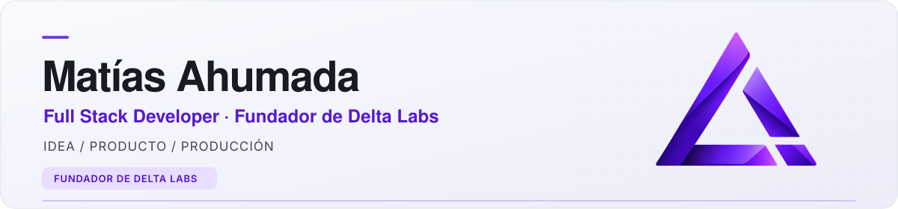
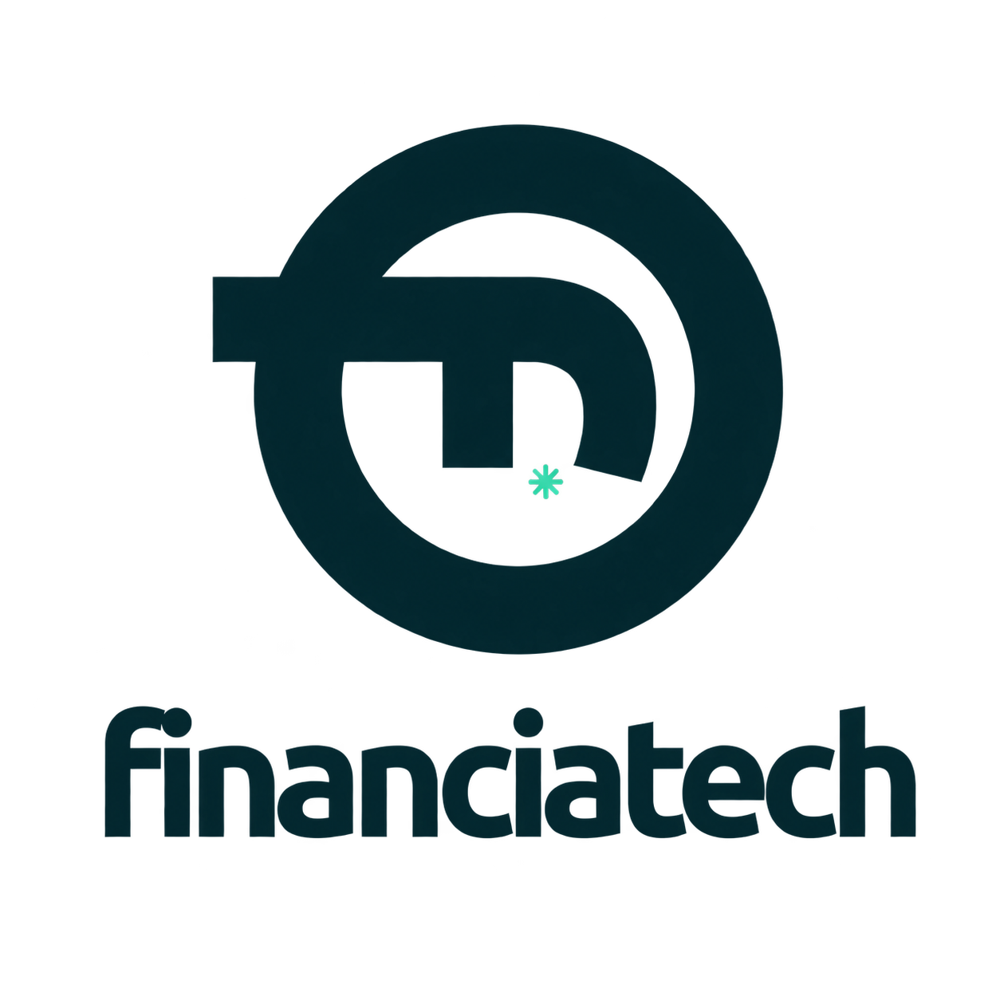
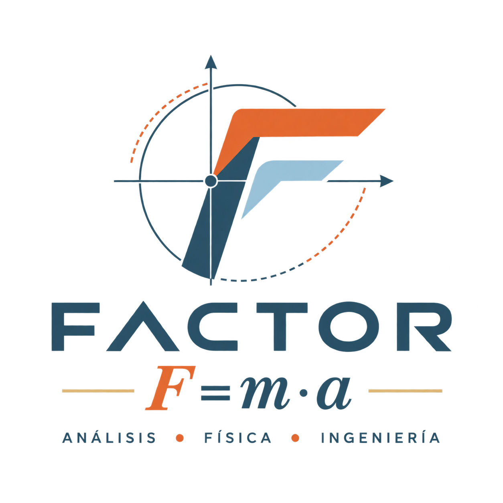
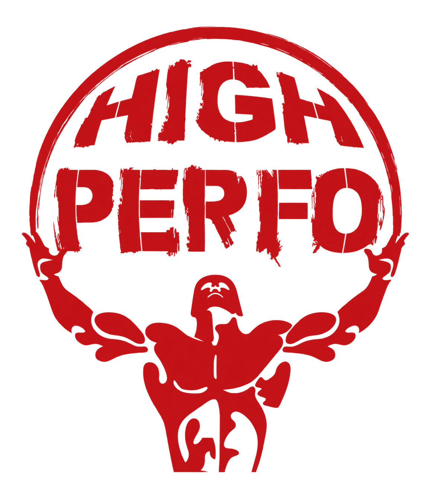

De la idea a producción: diseño, desarrollo y despliegue de productos digitales.
 

Fundador de Delta Labs · Desarrollador Full Stack · Estudiante de Ingeniería en Sistemas en la UTN

---

## 🧭 De punta a punta

Soy desarrollador **Full Stack** y acompaño todo el recorrido de un producto: entender el negocio, definir una primera solución, diseñar la experiencia y construir el frontend, el backend y sus integraciones.

También me encargo de la infraestructura: **servidores Linux, configuración de servicios, automatización de despliegues y mantenimiento en producción**. Desarrollo para web, móvil y escritorio, y sigo acompañando la evolución del producto después de entregarlo.

> **Δ Estoy construyendo [Delta Labs](https://deltalab.cloud)**, mi startup de software. Partimos de un problema real, construimos un MVP y lo hacemos crecer con nuevos módulos, automatizaciones e integraciones cuando el negocio lo necesita.

## 🚀 Proyectos destacados

<picture>
  <source media="(prefers-color-scheme: dark)" srcset="assets/projects/financiatech-white-transparent.svg">
  
</picture>

### FinanciaTech

**FINTECH** &nbsp; / &nbsp; Web + Android + Desktop

Un ecosistema para la **venta financiada y gestión de dispositivos Android**: plataforma web para clientes, cuotas y cobranzas; app móvil con comunicación remota por Firebase; y una herramienta portable de escritorio para preparar los equipos.

Integra pagos con Mercado Pago y gestión de licencias, con conciliación y controles para evitar acreditaciones duplicadas.

`Next.js` · `React Native / Expo` · `Electron` · `Firebase` · `PostgreSQL`

---

### El Campus de Fran

**EDTECH** &nbsp; / &nbsp; Educación + Video

Una plataforma educativa con experiencias para docentes y alumnos: materias, clases y **acceso a videos según la matrícula y su vigencia**.

Integra Mux para carga directa, procesamiento por webhooks y reproducción con tokens firmados, además de un panel de consumo audiovisual para docentes.

`Next.js` · `TypeScript` · `Mux Video` · `Prisma` · `PostgreSQL`

---

### High-Perfo

**SPORTSTECH** &nbsp; / &nbsp; Entrenamiento + Datos

Una plataforma deportiva que conecta **evaluaciones de atletas, análisis de rendimiento y planificación de entrenamientos**. Permite comparar resultados y definir cargas a partir de evaluaciones, perfiles teóricos o indicaciones del entrenador.

Incluye gestión de cuentas con datos aislados, gráficos de evolución y entrega de rutinas en PDF por Gmail mediante OAuth.

`Next.js` · `TypeScript` · `Prisma` · `PostgreSQL` · `Recharts` · `Google OAuth`

*Estos proyectos tienen repositorios privados. Podés conocer más y explorar las demos en [Delta Labs](https://deltalab.cloud), o [escribirme](mailto:matiasahu772@gmail.com).*

<strong>También podés explorar mi código público</strong>

- **[Merendar](https://github.com/MatiasAhumada/merendar):** gestión comunitaria con captura sin conexión y sincronización sin duplicar operaciones.
- **[Service Tech](https://github.com/MatiasAhumada/listado-st):** SaaS para talleres, con presupuestos, reparaciones y datos aislados por negocio.
- **[Generic Nest Prisma](https://github.com/MatiasAhumada/generic-nest-prisma):** base reutilizable para APIs con autenticación, repositorios, validación y Docker.

## ⚡ Con qué trabajo

| Backend y datos | Web, móvil y escritorio | Infraestructura e integraciones |
| --- | --- | --- |
| NestJS · Node.js · TypeScript | Next.js · React | Linux · VPS · Nginx |
| PostgreSQL · Prisma · TypeORM | React Native · Expo · Electron | Docker · PM2 · GitHub Actions |
| APIs REST · JWT · Zod | Tailwind CSS · shadcn/ui | Mercado Pago · Mux · Firebase |

<strong>Un poco más sobre mi recorrido</strong>

- Desarrollador freelance desde febrero de 2025.
- Anteriormente, Full Stack Developer en RollingCode Studio (julio de 2024 a febrero de 2025).
- Estudiante de Ingeniería en Sistemas de Información en la Universidad Tecnológica Nacional.
- También trabajé con Express, MongoDB y TypeORM.
- Me interesa convertir lo aprendido en cada proyecto en una base más clara y reutilizable para el siguiente.

---

### ¿Construimos algo?

Estoy abierto a proyectos de desarrollo integral y oportunidades Full Stack.
 
**[Conectemos en LinkedIn](https://linkedin.com/in/matias-ahumada-dev)** · **[Escribime por correo](mailto:matiasahu772@gmail.com)**

[Conocé Delta Labs ↗](https://deltalab.cloud)

