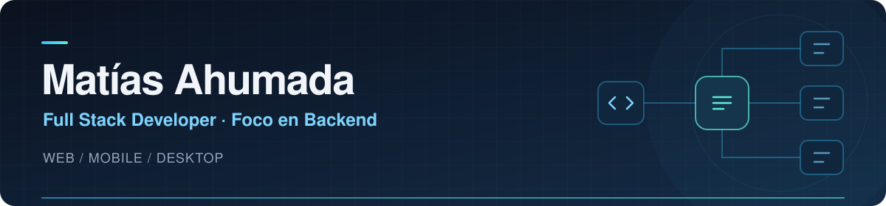

Construyo productos que conectan plataformas web, aplicaciones móviles y servicios.
 

Desarrollador freelance · Estudiante de Ingeniería en Sistemas en la UTN

---

## 🧭 Lo que me gusta construir

Me interesan los proyectos donde hay que conectar varias piezas: reglas de negocio, pagos, contenido, dispositivos y personas. Mi foco está en el backend, pero también desarrollo interfaces, aplicaciones móviles y herramientas de escritorio.

Trabajo principalmente con **TypeScript, NestJS, Next.js y PostgreSQL**, desde el modelo de datos hasta el despliegue.

## 🚀 Proyectos destacados

### 📱 FinanciaTech

**FINTECH** &nbsp; / &nbsp; Web + Android + Desktop

Un ecosistema para la **venta financiada y gestión de dispositivos Android**: plataforma web para clientes, cuotas y cobranzas; app móvil con comunicación remota por Firebase; y una herramienta portable de escritorio para preparar los equipos.

Integra pagos con Mercado Pago y gestión de licencias, con conciliación y controles para evitar acreditaciones duplicadas.

`Next.js` · `React Native / Expo` · `Electron` · `Firebase` · `PostgreSQL`

---

### 🎓 El Campus de Fran

**EDTECH** &nbsp; / &nbsp; Educación + Video

Una plataforma educativa con experiencias para docentes y alumnos: materias, clases y **acceso a videos según la matrícula y su vigencia**.

Integra Mux para carga directa, procesamiento por webhooks y reproducción con tokens firmados, además de un panel de consumo audiovisual para docentes.

`Next.js` · `TypeScript` · `Mux Video` · `Prisma` · `PostgreSQL`

---

### 🏋️ High-Perfo

**SPORTSTECH** &nbsp; / &nbsp; Entrenamiento + Datos

Una plataforma deportiva que conecta **evaluaciones de atletas, análisis de rendimiento y planificación de entrenamientos**. Permite comparar resultados y definir cargas a partir de evaluaciones, perfiles teóricos o indicaciones del entrenador.

Incluye gestión de cuentas con datos aislados, gráficos de evolución y entrega de rutinas en PDF por Gmail mediante OAuth.

`Next.js` · `TypeScript` · `Prisma` · `PostgreSQL` · `Recharts` · `Google OAuth`

*Estos proyectos tienen repositorios privados. Si te interesa conocer más sobre mi trabajo, [conversemos](mailto:matiasahu772@gmail.com).*

<strong>También podés explorar mi código público</strong>

- **[Merendar](https://github.com/MatiasAhumada/merendar):** gestión comunitaria con captura sin conexión y sincronización sin duplicar operaciones.
- **[Service Tech](https://github.com/MatiasAhumada/listado-st):** SaaS para talleres, con presupuestos, reparaciones y datos aislados por negocio.
- **[Generic Nest Prisma](https://github.com/MatiasAhumada/generic-nest-prisma):** base reutilizable para APIs con autenticación, repositorios, validación y Docker.

## ⚡ Con qué trabajo

| Backend y datos | Web, móvil y escritorio | Integraciones y despliegue |
| --- | --- | --- |
| NestJS · Node.js · TypeScript | Next.js · React | Mercado Pago · Mux · Firebase |
| PostgreSQL · Prisma · TypeORM | React Native · Expo · Electron | GitHub Actions · VPS · PM2 |
| APIs REST · JWT · Zod | Tailwind CSS · shadcn/ui | Docker · Git |

<strong>Un poco más sobre mi recorrido</strong>

- Desarrollador freelance desde febrero de 2025.
- Anteriormente, Full Stack Developer en RollingCode Studio (julio de 2024 a febrero de 2025).
- Estudiante de Ingeniería en Sistemas de Información en la Universidad Tecnológica Nacional.
- También trabajé con Express, MongoDB y TypeORM.
- Me interesa convertir lo aprendido en cada proyecto en una base más clara y reutilizable para el siguiente.

---

### ¿Construimos algo?

Estoy abierto a proyectos freelance y oportunidades en backend o full stack.
 
**[Conectemos en LinkedIn](https://linkedin.com/in/matias-ahumada-dev)** · **[Escribime por correo](mailto:matiasahu772@gmail.com)**

